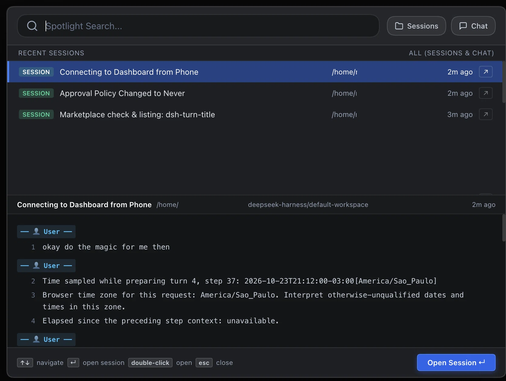

# dsh-spotlight

English | [Português (Brasil)](README.pt-BR.md) | [中文](README.zh.md)

A DeepSeek Harness (DSH) plugin that replaces the sidebar search with an Apple Spotlight and IntelliJ/PyCharm-style centered search dialog for sessions and chat messages.



---

## Features

- **Apple Spotlight Centered Modal:** Triggered by clicking the search magnifying glass in the sidebar or via `Cmd+K` / `Ctrl+K`. Opens an elegant, centered search dialog over the application.
- **Filter Selector:** Seamlessly switch between searching **Sessions**, **Chat messages**, or both at the same time (default).
- **IntelliJ / PyCharm "Find in Path" Layout:**
  - **Top Pane (Search Results):** Displays matching sessions and chat message excerpts with query term highlights, relative timestamps, and directory tags.
  - **Bottom Pane (Live Context Preview):** Shows live, line-numbered dialogue context (user & assistant turns) with highlighted search hits.
- **Keyboard Navigation & Quick Actions:**
  - `↑` / `↓` to navigate search results.
  - `Enter` or double-click to immediately open the selected session.
  - Quick open button (`↗`) on each result item.
  - `Esc` to close.
- **Immediate Live Search & SQLite FTS:** Searches active live session inboxes in real-time, backed by SQLite FTS for persistent conversation history.
- **Fully Mobile-Optimized:** Responsive full-screen mobile view, single-tap session navigation, dedicated `✕` close button, virtual keyboard compatibility, and automatic sidebar drawer retraction.
- **Theme-Native:** Uses DSH `--dsw-alias-*` theme tokens to match light and dark modes seamlessly.

---

## Installation

### Via DSH Plugin Market (`dshmarket`)
Search for `dsh-spotlight` in the DSH Plugin Marketplace and click **Install**.

### Via DSH CLI
```bash
dsh plugin --profile web add dsh-spotlight
```

### From Local Source
```bash
git clone https://github.com/mdalboni/dsh-spotlight.git
dsh plugin --profile web add link:./dsh-spotlight
```

---

## Testing

Run the unit test suite using Node.js built-in test runner:

```bash
node --test test/index.test.js
```

---

## License

MIT © Maxwell Dalboni
