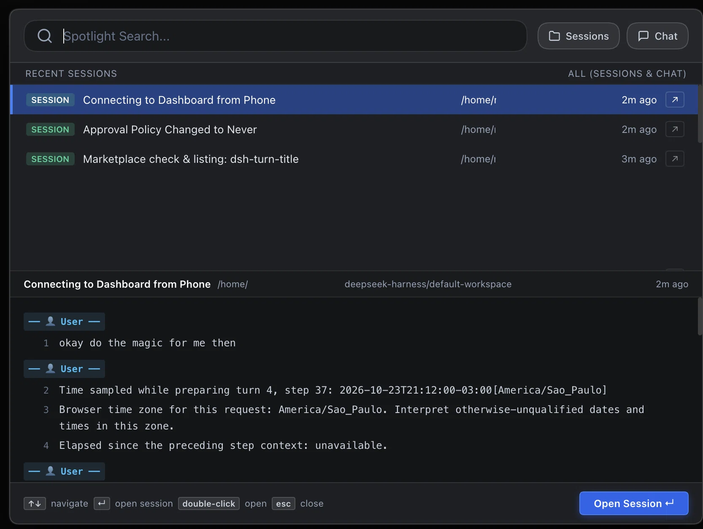

# dsh-spotlight

[English](README.md) | Português (Brasil) | [中文](README.zh.md)

Plugin para o DeepSeek Harness (DSH) que substitui a busca da barra lateral por uma caixa de diálogo centralizada no estilo Apple Spotlight e IntelliJ/PyCharm para busca rápida de sessões e conversas de chat.



---

## Funcionalidades

- **Diálogo Centralizado Estilo Spotlight:** Acionado ao clicar na lupa de busca da barra lateral ou pelo atalho `Cmd+K` / `Ctrl+K`. Abre uma interface elegante sobreposta no centro da tela.
- **Filtros Flexíveis:** Alterne rapidamente entre buscar apenas **Sessões**, apenas **Chat**, ou em ambos simultaneamente (padrão quando nenhum está selecionado).
- **Layout Inspirado no "Find in Path" do IntelliJ / PyCharm:**
  - **Painel Superior (Resultados):** Lista as sessões e trechos de mensagens encontrados com destaque do termo buscado, horário relativo e caminho do workspace.
  - **Painel Inferior (Prévia Contextual):** Exibe a conversa em tempo real com numeração de linhas, identificação de turnos (Usuário / Assistente) e linha destacada.
- **Navegação por Teclado e Abertura Rápida:**
  - Setas `↑` / `↓` para navegar pelos resultados.
  - Tecla `Enter` ou duplo clique para abrir a sessão diretamente.
  - Botão de atalho rápido (`↗`) em cada item da lista.
  - Tecla `Esc` para fechar o diálogo.
- **Busca em Tempo Real e FTS SQLite:** Localiza mensagens da sessão atual em tempo real no cache local e utiliza o motor SQLite FTS para o histórico persistido.
- **Nativo ao Tema:** Respeita os tokens de estilo do DSH (`--dsw-alias-*`), adaptando-se a temas claros e escuros.

---

## Instalação

### Pelo Marketplace do DSH (`dshmarket`)
Busque por `dsh-spotlight` no Marketplace do DSH e clique em **Install**.

### Via CLI do DSH
```bash
dsh plugin --profile web add dsh-spotlight
```

### A partir do Código Fonte Local
```bash
git clone https://github.com/mdalboni/dsh-spotlight.git
dsh plugin --profile web add link:./dsh-spotlight
```

---

## Testes

Execute a suíte de testes com o test runner nativo do Node.js:

```bash
node --test test/index.test.js
```

---

## Licença

MIT © Maxwell Dalboni
