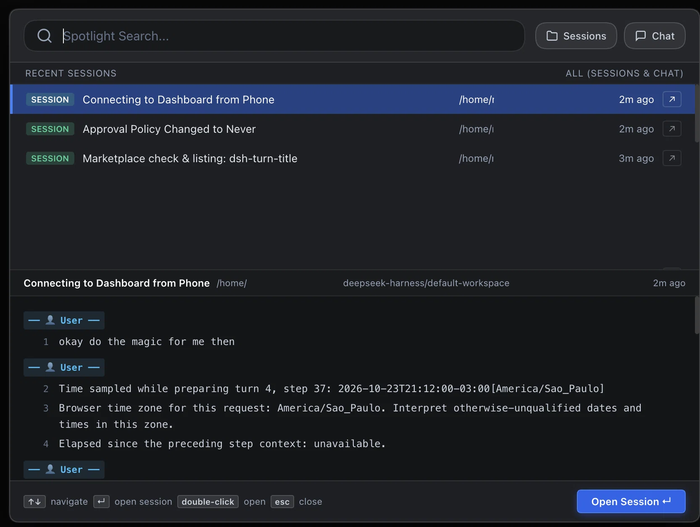

# dsh-spotlight

[English](README.md) | [Português (Brasil)](README.pt-BR.md) | 中文

为 DeepSeek Harness (DSH) 打造的会话与聊天内容全局搜索插件，替换侧边栏搜索框，提供类似苹果 Spotlight 与 IntelliJ / PyCharm 的居中弹窗搜索体验。



---

## 功能特性

- **苹果 Spotlight 风格居中弹窗：** 点击侧边栏搜索放大镜图标或按下 `Cmd+K` / `Ctrl+K` 快速呼出居中全局弹窗。
- **类型过滤选择器：** 自由切换仅搜索 **会话名称 (Sessions)**、仅搜索 **聊天内容 (Chat)**，或同时全局匹配（默认）。
- **IntelliJ / PyCharm "Find in Path" 双栏结构：**
  - **上栏（匹配结果列表）：** 显示匹配到的会话与消息摘录、查询词高亮、相对时间和所属工作区。
  - **下栏（上下文实时预览）：** 带行号展示选中会话的历史对话（用户与助手轮次），精确定位并高亮匹配行。
- **键盘导航与快捷操作：**
  - `↑` / `↓` 切换选中项。
  - `Enter` 或双击直接跳转并打开目标会话。
  - 每行右侧快捷打开按钮 (`↗`)。
  - `Esc` 快速关闭。
- **实时缓存与 SQLite FTS 全文索引：** 实时索引当前活跃对话，结合 SQLite FTS 检索持久化历史会话。
- **原生主题兼容：** 基于 DSH `--dsw-alias-*` 主题变量开发，自动无缝适配深色与浅色模式。

---

## 安装方式

### 通过 DSH 插件市场 (`dshmarket`)
在 DSH 插件市场中搜索 `dsh-spotlight` 并点击 **Install**。

### 通过 DSH CLI 命令行
```bash
dsh plugin --profile web add dsh-spotlight
```

### 本地源码安装
```bash
git clone https://github.com/mdalboni/dsh-spotlight.git
dsh plugin --profile web add link:./dsh-spotlight
```

---

## 运行测试

使用 Node.js 内置测试套件执行单元测试：

```bash
node --test test/index.test.js
```

---

## 开源协议

MIT © Maxwell Dalboni
